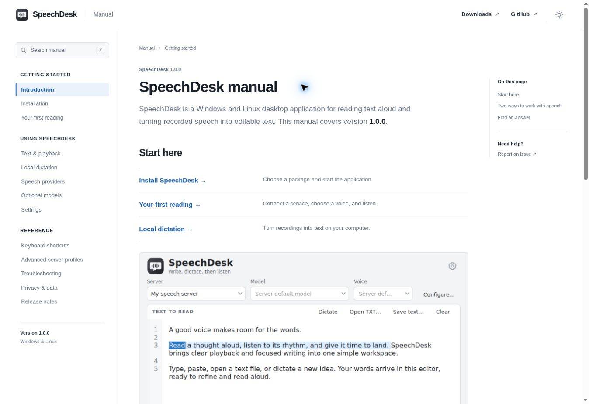

# SpeechDesk Manual

The user manual for [SpeechDesk](https://github.com/Davoda1/Speech-Desk), a native Windows and Linux application for text-to-speech playback and local dictation.

[Read the manual](https://davoda1.github.io/Speech-Desk-Manual/) · [Download SpeechDesk](https://github.com/Davoda1/Speech-Desk/releases)

The website covers installation, speech providers, playback, dictation, optional model packs, encrypted API-key storage, settings and troubleshooting. It uses ordinary HTML pages with a persistent chapter navigation, on-page contents and browser-only search. All fonts, images, styles and scripts are local; the site has no analytics, external embeds or runtime dependencies.



## Build

Python 3.12 or later is recommended.

```sh
python -m pip install -r requirements.txt
python scripts/build.py
python scripts/check.py
```

Open `dist/index.html` directly, or serve `dist/` with a static web server. The search index is a local script, so search also works when the files are opened from disk. The build works at a domain root or a subdirectory such as `/Speech-Desk-Manual/`.

## Edit the manual

Write article content in `content/`. Page order and titles live in `scripts/build.py`; site styling and behavior live in `assets/`. Rebuild after editing. Content describes SpeechDesk **1.1.0**; check instructions against the application before documenting a later version.

The included screenshots show the application, not a separate browser implementation. The website stores only its chosen color theme in the browser. Search queries stay in the browser.

## Hosting

The manual is published at **[davoda1.github.io/Speech-Desk-Manual](https://davoda1.github.io/Speech-Desk-Manual/)**.

GitHub Pages uses GitHub Actions as its build source. The **Deploy manual to GitHub Pages** workflow validates and publishes `dist/` after each push to `master`; it can also be run manually. The **Build manual** workflow checks pull requests and pushes, and uploads a ready-to-host `speechdesk-manual` artifact. The generated files can also be deployed to any static host.

## License

MIT, copyright © 2026 davoda1. Application screenshots and icon are from SpeechDesk.
